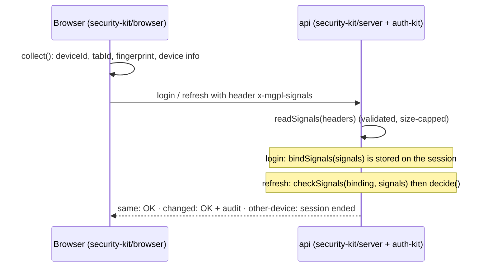

<div align="center">

# security-kit

**Security primitives for both sides of MGPL Diagnostics.**
Device signals collected in any frontend and checked on the backend, plus the server helpers every
endpoint needs. Zero dependencies.

  

</div>

```bash
# .npmrc: @mgpl-diagnostics:registry=https://npm.pkg.github.com (a token with read:packages)
npm install @mgpl-diagnostics/security-kit
```

## Entries

| Import | Runs in | What it has |
| --- | --- | --- |
| `@mgpl-diagnostics/security-kit` | everywhere (browser, Node.js, workers, React Native) | `DeviceSignals` types, `SIGNALS_HEADER`, `encodeSignals` / `decodeSignals` (validated), `randomId`, `sha256Hex`, `constantTimeEqual`, base64url, `canonicalJson` |
| `@mgpl-diagnostics/security-kit/browser` | any frontend, any framework | `createSignalCollector`, `deviceInfo`, pluggable storage (`webStorage`, `memoryStorage`, or your own sync/async store) |
| `@mgpl-diagnostics/security-kit/server` | Node.js ≥ 20 | `readSignals`, `bindSignals`, `checkSignals`, `decide`; `clientIp` behind proxies; `securityHeaders`, `corsPolicy`; `redact`, `maskEmail`, `maskPhone`; adapters for Express, Fastify and Fetch-standard servers |
| `@mgpl-diagnostics/security-kit/react` | React ≥ 18 (optional peer) | `useDeviceSignals(collector)` |

Both `/browser` and `/server` re-export the shared entry.

## Works with any library

Nothing here imports a framework. The adapters match each library's hook shape, so they add no
dependency, and anything not listed uses `collector.headers()` or `subscribe` / `getSnapshot` directly.

| You use | Plug in |
| --- | --- |
| `@mgpl-diagnostics/client` | `createMgplGraphQLClient({ headers: () => signals.headers() })` |
| plain `fetch`, graphql-request, urql, Apollo `HttpLink`, ofetch, wretch | `fetch: signalFetch(signals)` |
| TanStack Query, SWR, RTK Query, Vue Query | call your client (or `signalFetch(signals)`) inside the query function; nothing else |
| axios | `axios.interceptors.request.use(axiosSignals(signals))` |
| ky | `ky.create({ hooks: { beforeRequest: [kySignals(signals)] } })` |
| Apollo Client | `setContext(apolloSignals(signals))` |
| graphql-ws, socket.io, Angular `HttpClient`, anything with a headers object | `await mergeSignalHeaders(signals, headers)` |
| React | `const s = useDeviceSignals(signals)` from `/react` |
| Svelte | `const store = signalStore(signals)`, then `$store` |
| Vue | `const s = shallowRef(signals.getSnapshot()); signals.subscribe((v) => (s.value = v))` |
| Solid, Angular signals, RxJS, MobX | wrap `signals.subscribe` / `signals.getSnapshot` (or `signalStore`) |
| React Native, Electron, Capacitor | pass `storage` / `environment` (see below) |

| Server | Plug in |
| --- | --- |
| Fastify | `await app.register(fastifySecurity({ cors: { origins }, trustedHops: 1 }))` → `request.security` |
| Express, Connect, node:http | `app.use(expressSecurity({ cors: { origins } }))` → `req.security` |
| Hono, Next.js route handlers, Bun, Deno, workers, GraphQL Yoga | `fetchSecurity(opts).handle(request, remoteAddress)` → `{ security, headers, preflight }` |
| anything else, or a GraphQL context | `requestSecurity({ headers, remoteAddress, trustedHops })` → `{ ip, signals, userAgent, origin }` |

`security.signals` is already validated (or `null`). Leave `cors` unset when another plugin
(`@fastify/cors`, Yoga's own CORS) already handles it.

## Device signals



### What is collected

| Field | Source | Kept where |
| --- | --- | --- |
| `deviceId` | 128-bit random id, created once | browser `localStorage` (`mgpl.deviceId`) |
| `tabId` | 128-bit random id per tab | browser `sessionStorage` (`mgpl.tabId`) |
| `fingerprint` | SHA-256 (first 32 hex) of: OS, browser family, mobile, `navigator.platform`, language, time zone, screen size, colour depth, CPU cores, device memory, touch points | sent only |
| `device` | OS, browser and major version, mobile, language, time zone, screen size | sent only |
| `app` | the app's version, if the app sets one | sent only |

No canvas, audio, WebGL or font probing, no IP lookup, nothing sent to third parties. The browser version
is left out of the fingerprint so updates don't change it. On the server, `bindSignals` stores
**SHA-256 hashes of the ids**, never the ids themselves.

### Browser

```ts
import { createSignalCollector } from "@mgpl-diagnostics/security-kit/browser";

export const signals = createSignalCollector({ app: "lab-panel@1.4.0" });

// any fetch wrapper, GraphQL client or query library
const res = await fetch("/graphql", {
  method: "POST",
  headers: { "content-type": "application/json", ...(await signals.headers()) },
  body: JSON.stringify({ query, variables }),
});

await signals.reset(); // "forget this device", e.g. after signing out on a shared computer
```

React Native or other runtimes pass their own storage and environment:

```ts
createSignalCollector({
  storage: { get: (k) => AsyncStorage.getItem(k), set: (k, v) => AsyncStorage.setItem(k, v), remove: (k) => AsyncStorage.removeItem(k) },
  tabStorage: memoryStorage(),
  environment: () => ({ navigator: { userAgent: "MGPL-App/2.0 (Android 14)", language: "en-IN" }, screen: { width: 1080, height: 2400 } }),
});
```

### Server

```ts
import { bindSignals, checkSignals, decide, readSignals } from "@mgpl-diagnostics/security-kit/server";

// login: store the binding with the session
const signals = readSignals(request.headers); // null when missing or invalid
session.signals = signals ? bindSignals(signals) : null;

// refresh: compare
const check = checkSignals(session.signals, readSignals(request.headers));
const { allow, log } = decide(check, { rejectOtherDevice: true, requireSignals: false });
if (log) audit({ action: "auth.signals_" + check.verdict, meta: { changes: check.changes } });
if (!allow) endSession();
```

| Verdict | Meaning | Default decision |
| --- | --- | --- |
| `same` | same device id and fingerprint (another tab or a browser update is still `same`) | allow |
| `changed` | same device id; fingerprint, OS, browser, form factor, language, time zone or screen changed | allow, log |
| `other-device` | a different device id: the token is used from another browser | **reject**, log |
| `missing` | the session is bound but the request sent no valid signals | allow, log (`requireSignals: true` rejects) |
| `unbound` | the session has no binding (older session or non-browser client) | allow |

Signals are a second line of defence, not proof of identity: a determined attacker who steals a token can
also copy the ids. They make silent token reuse from another browser visible and stoppable.

## Server helpers

```ts
import { clientIp, corsPolicy, redact, securityHeaders } from "@mgpl-diagnostics/security-kit/server";

// behind one load balancer; X-Forwarded-For is ignored when trustedHops is 0 (the default)
const ip = clientIp({ remoteAddress: req.socket.remoteAddress, headers: req.headers, trustedHops: 1 });

const cors = corsPolicy({ origins: ["https://lab.example.in", "https://*.mgpl.example"] });
reply.headers({ ...securityHeaders(), ...cors.headers(req.headers.origin, req.method === "OPTIONS") });

logger.info(redact({ body, headers })); // passwords, tokens, cookies, keys → "[redacted]"
```

- `securityHeaders()`: HSTS, `nosniff`, `DENY` framing, `no-referrer`, a locked-down CSP for a JSON API,
  `Permissions-Policy`, `no-store`. Each can be changed or turned off (GraphiQL needs its own CSP).
- `corsPolicy()`: exact origins and `https://*.domain` patterns (never the bare domain, never another
  scheme), `"*"` only without credentials; preflights always allow `x-mgpl-signals`.
- `redact()`: deep copy with secrets hidden (`password`, `*Token`, `*Secret`, `authorization`, `cookie`,
  API keys, OTP…), bearer strings, `Headers`, `Map`, errors and cycles; add your own keys.
  `maskEmail` / `maskPhone` for patient contact details in logs.

## Develop

```bash
npm run typecheck   # also checks that the shared and browser parts compile without Node.js types
npm test            # 44 checks, including real Express and Fastify apps
npm run build && node scripts/check-dist.mjs
npm run llms        # regenerate llms-full.txt (CI fails when it is stale)
```

## Licence

All rights reserved. See [LICENSE](LICENSE).
